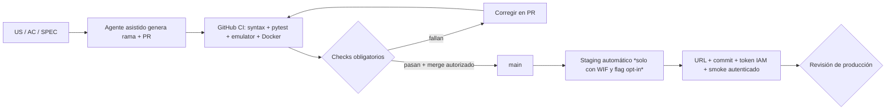

# SmartRoute Fast Lane — PA-SDD automatizado con validación continua
**Estado:** patrón implementado como workflows + documentación. **NO está configurada una identidad GCP WIF ni existe evidencia de despliegue staging.**

## Objetivo
Que el dueño del Capstone no sea el operador manual de cada comando de compilación, test, PR o deploy. Reglas y CI hacen trabajo repetitivo. Humanos definen alcance, revisan excepciones y autorizan producción, gastos nuevos, exposición pública y cambios de permisos.

## Ruta rápida y límites

### Flujo operativo por historia
1. Story lista con especificación mínima US/RF/AC y fixture.
2. Asistente implementa rama `feat/US-###-slug`, pruebas, documentación; crea PR. No guarda secretos.
3. PR ejecuta tests unitarios, integración Firestore Emulator y build de contenedor. La evaluación independiente (QA) puede detectar fallos y devolver el cambio al agente de código.
4. GitHub puede habilitar **auto-merge** para PR autorizados y con checks requeridos según reglas del repositorio. **Este repositorio no habilita auto-merge/branch protection desde un archivo**: es configuración administrativa, NO afirmar que quedó activo.
5. Merge a `main` activa CI; después de tests verdes, la tarea `deploy-staging` despliega una API privada a Cloud Run **solo si** `GCP_STAGING_ENABLED=true` y existe WIF/IAM.
6. El workflow obtiene un ID token de vida corta asociado al URL de Cloud Run y ejecuta `scripts/smoke-test.sh` contra `/health` y `/ready` (readiness de proceso, NO de Firestore). La evidencia queda en GitHub Actions Summary **solo cuando los checks pasan**. La autenticación Firebase de usuarios y persistencia Firestore del entorno staging requieren todavía un smoke de negocio por separado.
7. Producción, gastos nuevos, datos personales, exposición pública, IAM, cambio de arquitectura, eliminación o purga masiva: aprobación humana.

## Configuración ÚNICA necesaria por administrador del proyecto
**GitHub Repository → Settings → Secrets and variables → Actions → Variables**:
- `GCP_STAGING_ENABLED=true` (por defecto ausente: no despliega).
- `GCP_PROJECT_ID`: ID GCP elegido por el equipo.
- `GCP_REGION`: región GCP disponible.
- `GCP_WIF_PROVIDER`: recurso `projects/<NUMBER>/locations/global/workloadIdentityPools/<POOL>/providers/<PROVIDER>`.
- `GCP_DEPLOYER_SERVICE_ACCOUNT`: cuenta del pipeline con permisos de construir/publicar y desplegar staging.
- `GCP_RUNTIME_SERVICE_ACCOUNT`: cuenta distinta de runtime con privilegios mínimos para Firestore y servicios requeridos.
- `GCP_SMOKE_SERVICE_ACCOUNT`: identidad independiente de test, autorizada a invocar **solo** el servicio privado de staging (`roles/run.invoker`). Debe poder generar un ID token vía WIF: permisos `roles/iam.workloadIdentityUser` sobre la cuenta y capacidad `iam.serviceAccounts.getOpenIdToken` (revisar Token Creator según configuración). No dar permisos de administración del proyecto a esta cuenta.

**Configurar en GCP (administrador):**
- Firestore Standard Native mode en ubicación elegida; Firebase Auth para IDs de usuarios de la demo.
- Federation trust ligado al repositorio exacto `JuliusCordova/SmartRoute_AI`, solo ref `refs/heads/main` y audiencia correcta. Evitar credenciales JSON estáticas.
- Cuenta de despliegue: permisos mínimos de Cloud Run, Cloud Build/Artifact Registry necesarios según despliegue desde fuente, y `iam.serviceAccountUser` **solo sobre** runtime SA. Sin roles Owner/Editor.
- Runtime SA: acceso solo a Firestore y los servicios autorizados; cerrar ingreso no autenticado a Cloud Run. Aplicar restricciones de Firebase/Auth y roles desde FastAPI.
- Crear un **GitHub Environment staging** sin aprobación recurrente pero con restricción de rama main; *production* separado con aprobación explícita.
- El workflow valida previamente seis variables GCP, exige respuesta autenticada de `/health` y `/ready`, y falla si el token IAM o el servicio no funcionan. **No** valida aún login Firebase ni escritura de pedidos en Firestore real. Nunca mostrar tokens en los logs.
- Configurar reglas de rama en GitHub: CI obligatorio (unit, firestore emulator, Docker) + revisión humana para cambios de seguridad, infraestructura y datos. Optar por auto-merge en PR de bajo riesgo aprobados, no por bypass de branch protection.
- Budget alerts, límites de cuotas y revisión de API Google Maps / Gemini antes de habilitar esas funcionalidades.

## Estados verificables
| Gate | Automatización | Evidencia actual |
|---|---|---|
| PR unit/syntax/Docker | CI YAML | Ejecuciones exitosas previas en GitHub Actions |
| Firestore emulator integration | Firebase CLI job | Ejecuciones exitosas previas en GitHub Actions |
| Merge protegido / auto-merge | Configuración administrativa GitHub | **Pendiente** |
| WIF e IAM GCP | Configuración administrativa | **Pendiente** |
| Deploy staging privado | GitHub job opt-in | **No ejecutado** |
| Smoke autenticado en staging | Cloud Run IAM ID-token + script | **Código preparado, no ejecutado en GCP** |
| Gate producción | Aprobación humana | Mantener |

**Nota:** GitHub Actions no crea por sí solo infraestructura ni configura IAM. Este patrón reduce supervisión manual repetitiva, pero no significa que un agente pueda evolucionar software continuamente fuera de una sesión: hace falta un ejecutor conectado al repositorio o un proceso programado que cree nuevos PR.

Fuentes:
- https://github.com/google-github-actions/auth
- https://github.com/google-github-actions/deploy-cloudrun
- https://docs.github.com/en/repositories/configuring-branches-and-merges-in-your-repository/managing-protected-branches/about-protected-branches

## Elección actual de proyecto cloud

El usuario seleccionó `proyectopersonal-480420`. Leer [runbook de proyecto compartido](GCP_EXISTING_PROJECT_RUNBOOK.md) y ejecutar [preflight de solo lectura](../scripts/gcp-preflight.sh) antes de habilitar `GCP_STAGING_ENABLED=true`. El workflow verifica explícitamente el project ID y cuentas de servicio de ese proyecto. Si Firestore `(default)` ya tiene datos no relacionados, detener la habilitación; no mezclar colecciones ni crear bases facturables sin decisión expresa.
