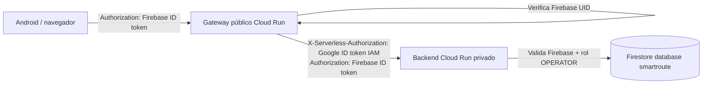

# SmartRoute AI — gateway Firebase → Cloud Run IAM (fase de implementación)

## Decisión técnica
Para permitir Android y navegador sin claves de servicio en cliente, establecer una **capa pública dedicada** `smartroute-gateway-staging`, pero Firebase-authenticated y con rutas explícitas. El backend `smartroute-api-staging` **permanece privado** y conserva su verificación de Firebase y rol `OPERATOR` en `users/{uid}` de Firestore nombrado `smartroute`.

Flujo:

Google Cloud Run admite oficialmente `X-Serverless-Authorization` para autenticación IAM cuando `Authorization` ya se usa por la app. Si están presentes ambos, Cloud Run verifica el primero y entrega el segundo a la aplicación. **No se requiere modificar el backend FastAPI ni confiar en cabeceras de identidad sin verificar.**

Referencia: https://docs.cloud.google.com/run/docs/authenticating/service-to-service

## Controles implementados en código
- Gateway con comprobación de proyecto y URL exacta del backend; está deshabilitado a falta de `SMARTROUTE_GATEWAY_ENABLED=true`.
- Firebase Admin SDK verifica el ID token del cliente antes de solicitar ID token IAM de Google; el backend vuelve a verificar Firebase y rol desde Firestore.
- El token de invocación Cloud Run se obtiene con ADC/metadata de la cuenta de servicio del gateway; **nunca se expone al cliente**.
- Solo operaciones permitidas: GET/POST `/api/v1/orders`, POST `/api/v1/routes`, POST `/api/v1/routes/{uuid}/orders`. No se permiten URLs o cabeceras arbitrarias.
- Cuerpos de solicitud limitados a 16 KiB; timeout upstream 15 segundos; sin redirects; no reenvía cookies, Host o cabeceras de cliente ajenas al contrato.
- CORS: origen web explícito configurable; nunca `*`. Android nativo puede omitir `Origin`.
- No añade acceso directo desde cliente a Firestore; backend es el único actor de datos.

## Infraestructura NO desplegada
Este PR **solo incluye código, Dockerfile, pruebas y documentación**. No crea cuentas, servicios, permisos IAM, Firebase users ni hace público `smartroute-api-staging`; no activa `GCP_STAGING_ENABLED`.

### Pasos para futura activación (requieren autorización aparte)
1. Revisar que Firebase Authentication esté habilitado en el proyecto y el proveedor de acceso elegido; esto podría afectar configuración del proyecto compartido. Definir usuario de prueba `OPERATOR`, perfil `users/{uid}` **solo en base `smartroute`** y criterio de borrado.
2. Crear cuenta dedicada `smartroute-gateway@proyectopersonal-480420.iam.gserviceaccount.com` sin permisos Firestore ni Token Creator de proyecto.
3. Conceder **solamente** `roles/run.invoker` a esa identidad sobre `smartroute-api-staging`. Mantener Cloud Run backend privado. Validar política sin `allUsers`.
4. Construir imagen `smartroute-gateway` en Artifact Registry SmartRoute y crear un servicio Cloud Run de gateway **separado**, con min instancias 0, max instancias bajo, cuenta dedicada, variables de configuración ancladas y acceso público únicamente a gateway. Implementar alertas, límites de costo y protecciones de abuso (p.ej. Cloud Armor / API Gateway según exposición).
5. En Android/web usar Firebase ID token en `Authorization`; nunca incluir el ID token IAM. CORS restringido a dominio exacto y política de orígenes. Para pruebas iniciales, comenzar con peticiones nativas sin browser Origin.
6. Probar 401 sin token, 401 con token inválido, 403 rol no autorizado, 201 con rol OPERATOR, lectura y asignación de rutas con datos sintéticos, limpieza y cierre de usuario de prueba.
7. Revisar latencia, cuotas, logs con campos no sensibles y recuperación de errores. Verificar denegación de invocación directa a backend desde clientes.
8. Automatizar despliegue solo tras revisión de seguridad, política de gasto, pruebas funcionales, rollback y autorización expresa.

## Limitaciones conscientes
La instancia pública del gateway podría recibir tráfico malicioso antes de validar el token, con costo/carga. La validación Firebase usa certificados públicos y puede consultar servicio externo; no imprimir tokens. Su límite de instancias no es límite de presupuesto. Las políticas CORS no reemplazan autenticación. El backend sigue sin un flujo HTTP E2E probado en GCP. El servicio público no está desplegado aún.
