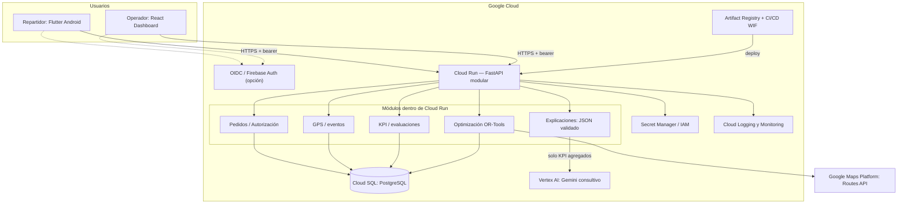

# Diagrama C4 simplificado — componentes GCP

**Alcance:** un Cloud Run modular; las cajas de dominio NO son microservicios independientes. Vertex AI sólo recibe datos agregados minimizados. La API de Maps está fuera del perímetro GCP del proyecto aunque es servicio Google.
