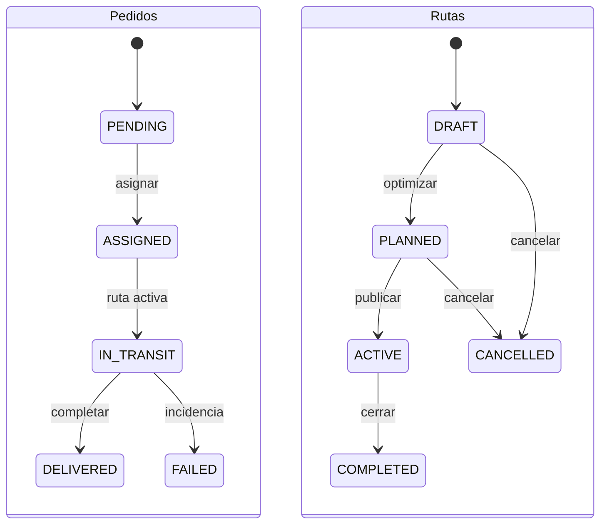

# Estados e invariantes

Cada cambio de estado exige autorización, versión de entidad y evento idempotente. GPS sólo cuando ruta ACTIVE y consentimiento explícito vigente; al completar/cancelar se detiene. Se debe definir con negocio si FAILED admite reintento (fuera de v1).
