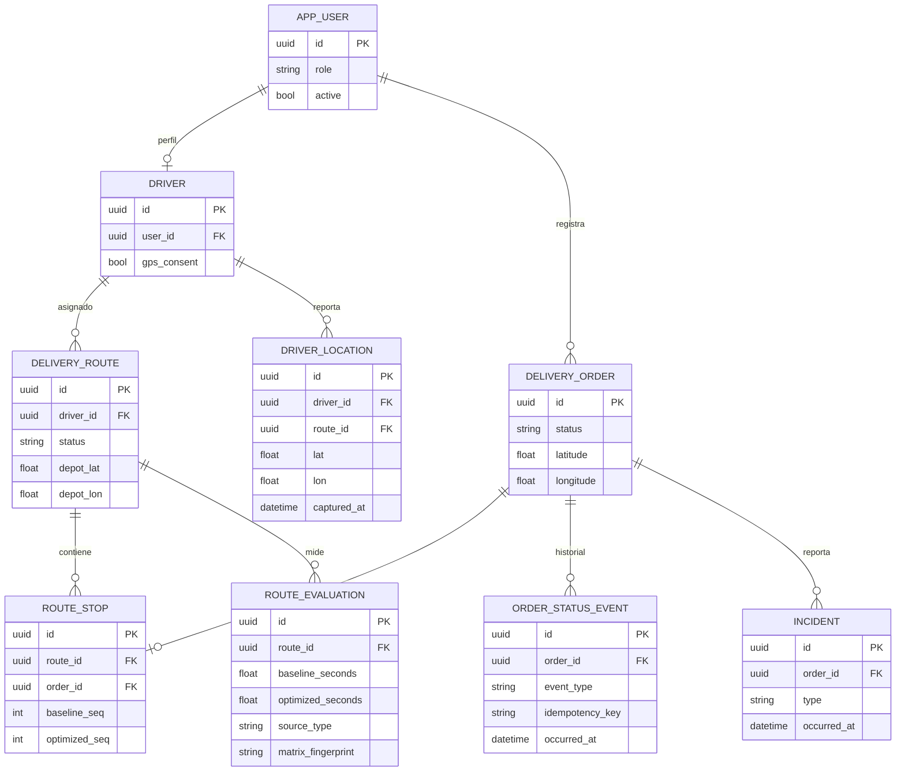

# Diagrama lógico relacional

DDL [schema.sql](../../db/schema.sql) se considera propuesta, no migración aplicada. Indexar eventos por ruta/tiempo, controlar claves únicas y política de retención GPS.
