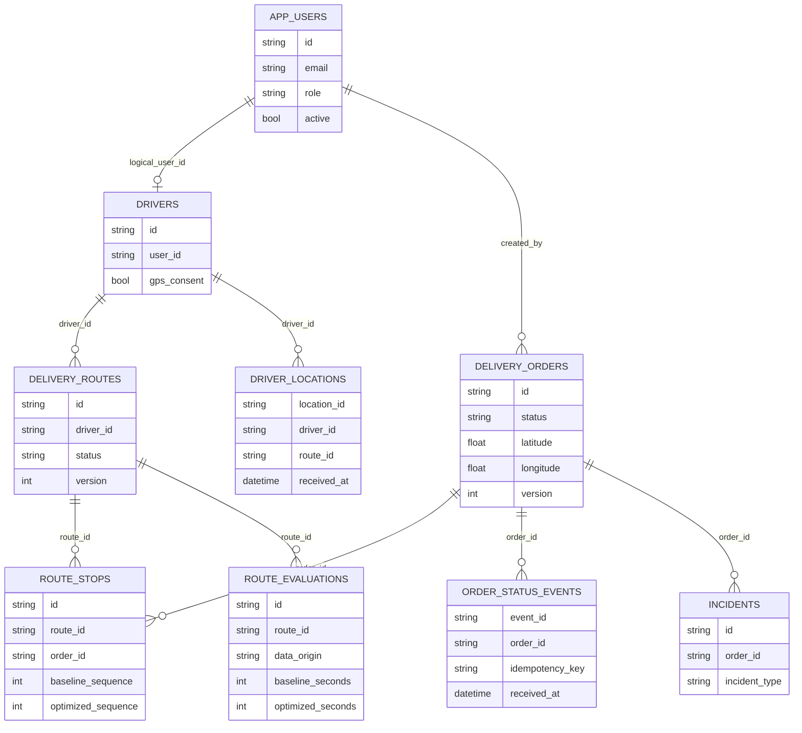

# Modelo lógico adaptado a BigQuery (piloto, no ERD transaccional)

**Atención:** las relaciones representan referencias lógicas, NO claves foráneas impuestas por BigQuery. Los controles de asignación, estado e idempotencia pertenecen a FastAPI y deben pasar pruebas. DDL vigente: [bigquery_schema.sql](../../db/bigquery_schema.sql). PostgreSQL histórico: [schema.sql](../../db/schema.sql), no ejecutarlo en GCP.
