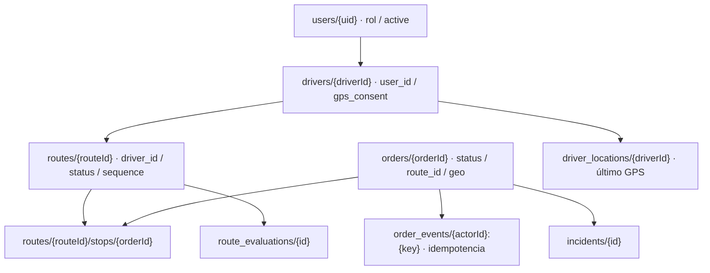

# Modelo lógico — Firestore Standard (documentos, no tablas)

**Referencias lógicas gestionadas por FastAPI**. Firestore no impone claves foráneas ni cascadas relacionales. Las transacciones coordinan asignaciones, eventos y estados. Ver [colecciones](../FIRESTORE_COLLECTIONS.md) y [ADR vigente](../FIRESTORE_STANDARD_MVP.md).
