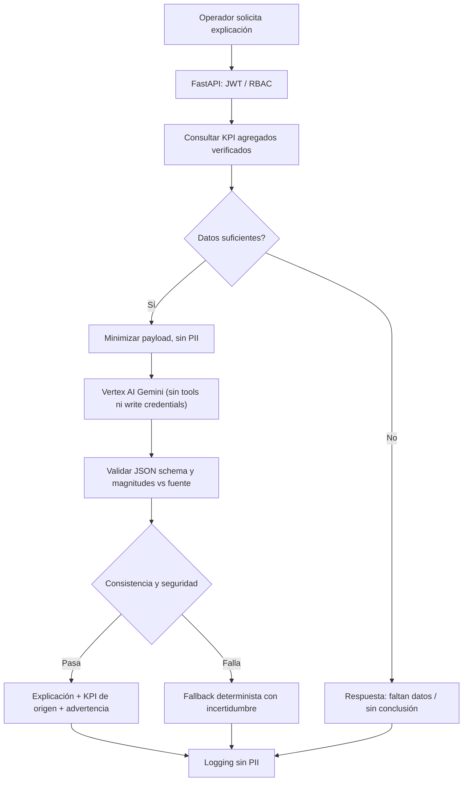

# Flujo LLM — consulta segura y evaluación

Prueba golden set: 20 casos (mejora negativa, n insuficiente, intento de modificación, prompt injection, datos ausentes, unidades). Objetivo: 0 KPI inventados, 0 cambios en DB, 0 filtraciones PII. IA no sustituye a OR-Tools ni gobierna permisos.
