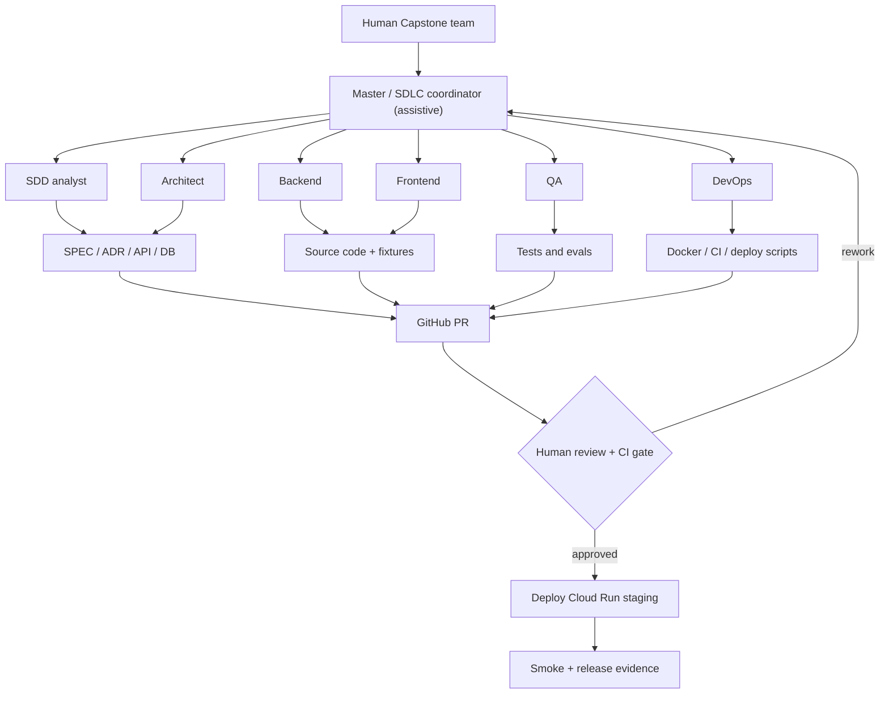

# PA-SDD assisted SDLC (build-time) ≠ SmartRoute runtime (product)

Actual model: roles/contracts are documentation; ADK orchestration is **not implemented**. Runtime product remains FastAPI + OR-Tools, with optional Gemini A1.
