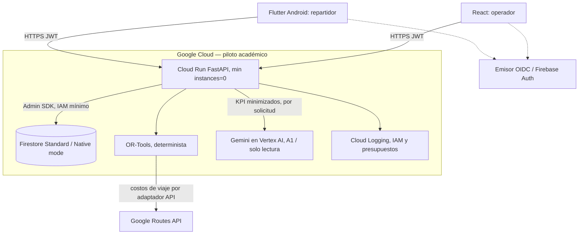

# Diagrama de componentes — Firestore Standard

La autorización del usuario se verifica en la API, incluso cuando el Admin SDK tenga acceso a Firestore. Android y React nunca disponen de credenciales de servicio. BigQuery y Cloud SQL no forman parte de la arquitectura activa del piloto.
