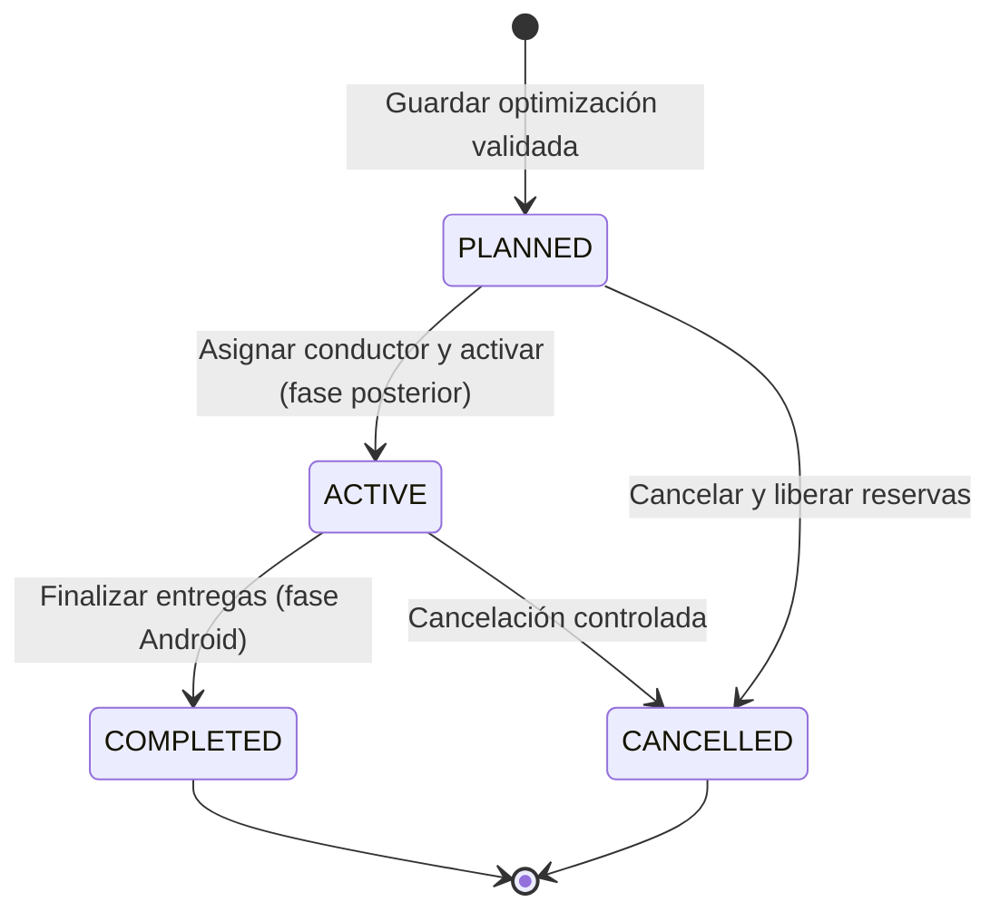
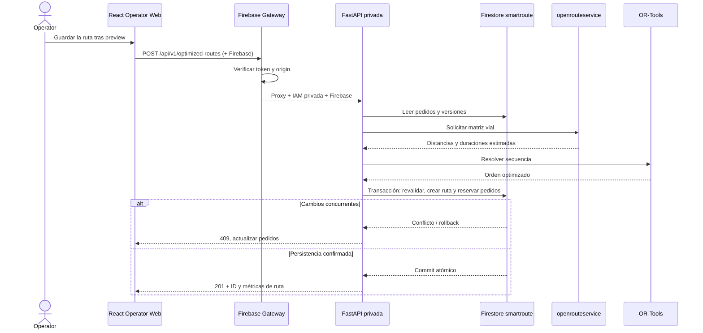

# US-010 — Persistencia y publicación controlada de rutas optimizadas (SDD)

**Proyecto:** SmartRoute AI, Capstone UPN · **Estado:** especificación propuesta, no implementada  
**Rama:** `feat/us010-persist-optimized-routes` · **Base:** `main` merge PR #53 (`5a75a64`)  
**Método:** SDD progresivo, especificación mínima suficiente (DevPattern), contratos y pruebas antes de despliegue.  
**Prioridad:** P0 · **Responsable funcional:** operador (web) · **Ámbito:** Lima piloto, 1 depósito, 1 vehículo, 1–10 pedidos simulados.

## 1. Contexto, problema y resultado esperado

El flujo existente `POST /api/v1/optimization/preview` usa ORS para la matriz vial y OR-Tools para una **previsualización** estimada, sin escrituras Firestore. El usuario ha probado la interfaz y guardado pedidos; en una demostración de **cinco destinos** el panel mostró **32 min / 18.55 km** como orden inicial y **25 min / 15.26 km** como orden propuesto, **19.43 %** de mejora reportada. **No es ahorro observado** ni prueba de óptimo global. Véase [evidencia del piloto](../docs/EVIDENCIA_PILOTO_5_PEDIDOS_2026-11-15.md).

**US-010:** *Como operador autenticado, quiero confirmar y guardar una secuencia optimizada, consultar sus métricas y recuperar la ruta después de recargar el navegador, para preparar su planificación y futura asignación a un conductor.*

**Fuera de alcance inmediato:** publicación a Android, activación de ruta, GPS y navegación real; se diseñan sus contratos de evolución sin afirmar implementación.

## 2. Inventario de código que se reutiliza

| Archivo / contrato | Existente | Reutilización o modificación propuesta |
|---|---|---|
| `services/api/app/route_preview.py` | `PreviewRequest`, `PreviewResult`, `compute_preview`; 1–10 paradas, matrícula vial estimada, huella | Mantener preview sin efectos; guardar mediante cálculo **servidor**, no confiar en métricas/orden enviados por el cliente |
| `services/api/app/routes.py` | `RouteStatus` DRAFT/PLANNED/ACTIVE/COMPLETED/CANCELLED, `RouteCreate(driver_id,depot)`, `Route` | Conservar compatibilidad del endpoint anterior; modelo nuevo `OptimizedRoute` con `driver_id: null` hasta asignación |
| `services/api/app/firestore_routes.py` | `create` exige `drivers/{id}`; `assign` transaccional para `DRAFT`, cambia pedidos a `ASSIGNED` | Agregar adaptador transaccional para ruta optimizada sin conductor; no reutilizar `assign` sin revisar estados/semántica |
| `services/api/app/auth.py` | Validación Firebase ID token + perfil `OPERATOR` en Firestore `smartroute` | Mantener `require_operator`; futura lectura DRIVER solamente para conductor asignado |
| `services/gateway/app/main.py` | Allowlist explícita, Firebase en edge, IAM de gateway→API privada y CORS por origen | Añadir rutas permitidas exactamente (sin comodín) |
| `apps/operator-web/src/main.jsx` | PREVIEW, seleccionar pedidos y visualizar mapa | Botón `Guardar ruta` y vista `Rutas guardadas` sin nuevas credenciales |

**Invariante no negociable:** `FIRESTORE_DATABASE_ID=smartroute`, backend privado por Cloud Run IAM, gateway comprueba Firebase y la API verifica OPERATOR; nunca tocar bases `(default)` ni `gestioncitas`.

## 3. Decisión funcional: ¿qué significa guardar?

**Estado inicial de una optimización confirmada: `PLANNED`, sin conductor.** Guardar una ruta reserva los pedidos y evita asignaciones duplicadas. El estado `DRAFT` queda para el flujo legado de rutas creadas manualmente; no degradar rutas PLANNED a DRAFT para poder asignar. Las modificaciones al flujo legado deben verificarse con pruebas de regresión.

Flujo de estados propuesto:



Un pedido `PENDING` pasa a `ASSIGNED` **al reservarlo en PLANNED**; `route_id` referencia la ruta. Durante la fase sin conductor, `ASSIGNED` significa *asignado a una ruta*, no *asignado a un conductor*. La UI debe mostrarlo así. La regla de exclusividad se impone por transacción Firestore, no por check del navegador.

## 4. Contratos de API propuestos (v1)

### 4.1. `POST /api/v1/optimized-routes` — guardar optimización

**Headers:** `Authorization: Bearer <Firebase ID token>`, `Idempotency-Key: <UUID>` opcional recomendado; acceso OPERATOR.

```json
{
  "depot": {"id": "depot", "latitude": -12.095, "longitude": -77.035},
  "order_ids": ["<uuid-pedido-1>", "<uuid-pedido-2>"],
  "idempotency_key": "<uuid-operacion>"
}
```

- Lista de pedidos ordenada como **línea base** del operador (1–10); solo acepta IDs reales presentes en Firestore, en `PENDING`, no asignados; rechazar duplicados.
- Servidor lee coordenadas **desde Firestore** y reconstruye `PreviewRequest`; no confía en latitud, longitud, tiempos, distancias ni secuencia optimizada del navegador.
- Servidor consulta matriz ORS y ejecuta OR-Tools antes de comenzar la transacción; usa límite de tiempo y manejo de 503/422. **No realizar llamadas externas dentro de la transacción**.
- En transacción: releer pedidos y validar que `version`, `status`, `route_id` y `geo` no cambiaron desde el cálculo; crear `routes/{route_id}` con `status=PLANNED` y reservar todos los pedidos. Si cambia algo, devolver `409` sin escrituras parciales.
- Guardar `ordered_order_ids` (secuencia) y `baseline_order_ids` (orden recibido) con los mismos IDs exactamente; el resultado del solver no puede omitir ni duplicar paradas.
- Respuesta `201 Created`: objeto `OptimizedRoute`. Un reintento con misma clave/operador y mismo payload devuelve la ruta existente (`200`) sin nueva reserva; mismo key con otro payload `409`. **Implementar comprobación idempotente transaccional**.
- Las respuestas deben indicar origen `estimated` y `openrouteservice`; no reproducir matriz vial íntegra ni secretos.

### 4.2. `GET /api/v1/optimized-routes?limit=20&cursor=...`

Retorna `{"items":[...],"next_cursor":null|string}`, orden estable y paginación acotada (`1..50`). Solo OPERATOR. No exponer información de otros usuarios ni tokens; pueden mostrarse datos piloto ficticios.

### 4.3. `GET /api/v1/optimized-routes/{route_id}`

Retorna ruta concreta con métricas guardadas, `404` si no existe; mismo RBAC. En el futuro, DRIVER solo podrá leer rutas activadas y asignadas específicamente a su perfil. No habilitar esa lectura de manera implícita ahora.

### 4.4. Asignar conductor / publicar (fase incremental separada)

Propuesta `POST /api/v1/optimized-routes/{route_id}/assign-driver` con `driver_id` y versión esperada. Requiere conductor existente/activo, transacción que verifica `status=PLANNED`; no altera secuencia ni vuelve a reservar pedidos. La transición a `ACTIVE` requiere guardas adicionales y contrato explícito. **No implementar dentro de la primera entrega de persistencia si no hay perfil DRIVER validado.**

## 5. Modelo de datos Firestore propuesto

`routes/{route_id}` (nuevo esquema discriminado con `route_type="OPTIMIZED"`; compatibilidad con documentos legados):

```json
{
  "id": "<uuid>",
  "route_type": "OPTIMIZED",
  "status": "PLANNED",
  "driver_id": null,
  "created_by": "<firebase-uid>",
  "depot": {"latitude": -12.095, "longitude": -77.035},
  "order_ids": ["<uuid-1>", "<uuid-2>"],
  "baseline_order_ids": ["<uuid-1>", "<uuid-2>"],
  "ordered_order_ids": ["<uuid-2>", "<uuid-1>"],
  "baseline_seconds": 0,
  "optimized_seconds": 0,
  "baseline_meters": 0,
  "optimized_meters": 0,
  "improvement_pct": 0.0,
  "matrix_provider": "openrouteservice",
  "matrix_fingerprint": "<sha256-hex>",
  "data_origin": "estimated",
  "warnings": [],
  "version": 1,
  "created_at": "<UTC-servidor>",
  "updated_at": "<UTC-servidor>"
}
```

**Notas:** los ceros son **placeholders de esquema**, nunca métricas válidas de una operación; almacenar valores calculados positivos cuando corresponda. Para geometría, preferir no persistir una ruta ORS extensa hasta verificar términos del proveedor; guardar solamente huella, métricas y orden de visita. Evitar persistir en documentos una copia de credenciales, tokens o respuesta completa del proveedor.

`orders/{id}` existentes: cambiar en la misma transacción `route_id`, `status=ASSIGNED`, `updated_at` (timestamp servidor), `version=Increment(1)`. Para idempotencia: `route_idempotency/{actorUid}:{keyHash}` o identificador equivalente no enumerable con `request_hash`, `route_id`, `created_at`; rechazar reutilización con payload distinto. Establecer política de retención antes de producción.

**Coordenadas/órdenes:** almacenar solo datos ficticios del piloto, no direcciones personales. La huella de matriz es evidencia de consistencia, **no** una forma de reconstruir valores del proveedor.

## 6. Secuencia de componentes



La previsualización previa puede no ser idéntica al cálculo de guardado si cambió la matriz vial. La UI **debe mostrar las métricas guardadas devueltas por el servidor** y advertir diferencias, en lugar de afirmar que persistió exactamente la previsualización anterior. Evolución futura: token de cotización de corto plazo / firma de preview y control de caducidad si se desea mantener igualdad estricta entre ambas operaciones.

## 7. Criterios de aceptación (Given / When / Then)

| ID | Given / When | Then |
|---|---|---|
| AC-01 | OPERATOR, 1–10 pedidos PENDING reales, ORS disponible; pulsa Guardar | Ruta `PLANNED` creada y pedidos reservados atómicamente |
| AC-02 | Recarga web y consulta la ruta | Mismo ID, orden de visita, duración/distancia/huella, origen `estimated` |
| AC-03 | Dos operadores intentan reservar un mismo pedido | Solo una operación confirma; otra `409`, sin escrituras parciales |
| AC-04 | IDs duplicados, no encontrados o fuera de Lima | `422` / `404` conforme contrato, ninguna escritura |
| AC-05 | Matriz incompleta o ORS sin clave | `422` / `503`, ninguna reserva |
| AC-06 | Sin Firebase o con rol DRIVER | `401` / `403`; no filtrar rutas |
| AC-07 | Reintento idéntico con igual clave idempotente | Misma ruta, sin duplicaciones; payload diferente `409` |
| AC-08 | Solicitud desde origen no permitido | Preflight o request `403` en gateway, sin acceso a API privada |
| AC-09 | Cambia estado/geo/versión entre cálculo y commit | `409` y no se reserva parcialmente |
| AC-10 | Se guardan distancias/tiempos | Figura `estimated`; no se presenta ahorro observado ni porcentaje inventado |

## 8. Pruebas de contrato, integración y regresión

- **Unitarias (pytest, mocks):** esquema Pydantic, 1–10 IDs únicos, RBAC y códigos HTTP, round-trip de serialización, orden del solver y validación de set/permutación, 503 ORS.
- **Integración Firestore Emulator:** transacciones con 2 pedidos concurrentes; reintentos; garantía sin escrituras parciales; errores por `route_id` existente; casos `PENDING` y `ASSIGNED`; list/get paginado; compatibilidad del test `test_route_transaction.py`.
- **Gateway:** allowlist estricta para POST/GET de rutas optimizadas, preflight OPTIONS y token ausente.
- **Frontend:** build React/Docker; botón Guardar habilitado solamente después de preview; mensajes 409/422; ruta visible tras recarga.
- **E2E staging:** cuenta OPERATOR, pedidos sintéticos y cuota ORS controlada, POST → GET → revisar 5 pedidos; capturar IDs y métricas **sin tokens ni API keys**.
- **Seguridad:** Firestore `smartroute` exclusivamente; IAM API privada intacto; no guardar raw matrix ni credenciales; mantener Cloud Run límites de instancias y gasto supervisado.

## 9. Backlog incremental

1. **US-010a — SDD y contratos**: este documento, revisión y criterios de aceptación.
2. **US-010b — Backend**: modelos optimizados, adaptador Firestore transaccional, API POST/GET y tests.
3. **US-010c — Gateway**: allowlist y pruebas CORS/RBAC.
4. **US-010d — Web**: Guardar ruta + Rutas guardadas, validación UX y recuperación.
5. **US-010e — CI, PR, staging**: tests, merge controlado, deploy API→gateway→web, E2E manual documentado.
6. **US-010f posterior — Asignar conductor y activar**: perfil DRIVER, transiciones y Android.

## 10. Riesgos y decisiones abiertas

- **Compatibilidad:** `RouteCreate` legado exige conductor y `assign` solo funciona en `DRAFT`. No cambiar sus semánticas silenciosamente; definir ruta optimizada nueva con esquema discriminado.
- **Integridad:** proceso ORS + solver se ejecuta fuera de transacción y requiere revalidación de versiones y posiciones antes de commit.
- **Proveedor externo:** tiempos y distancias pueden variar; guardar resultados de cálculo de guardado, no los números mostrados en preview como datos autoritativos.
- **Cuotas/costos:** salvar cada ruta reevalúa la matriz y consume ORS; no admitir reintentos automáticos sin idempotencia.
- **Timeout gateway:** `httpx.AsyncClient(timeout=15)`; la evaluación server-side con matriz + solver + geometría opcional puede excederlo. Diseñar endpoint de guardado que no requiera Directions, medir p95 y ajustar timeout de forma acotada antes de staging.
- **Auditoría:** `created_by`, timestamps UTC servidor, método y versión del solver, huella y origen; no almacenar datos personales de rutas reales en esta demo.
- **Cambio de instancia Cloud Run:** no desplegar ni modificar GCP hasta pasar CI y revisar variables de ambiente, acceso Firestore e IAM.

## 11. Definition of Done

Especificación versionada; endpoint implementado con pruebas unitarias y transaccionales; gateway restringido; web permite guardar y consultar; CI verde; E2E de cinco pedidos en `smartroute`; evidencia fechada y métricas clasificadas como estimadas; PR revisado y merge a main controlado. **Actualmente solo el SDD está preparado; el resto permanece pendiente.**
