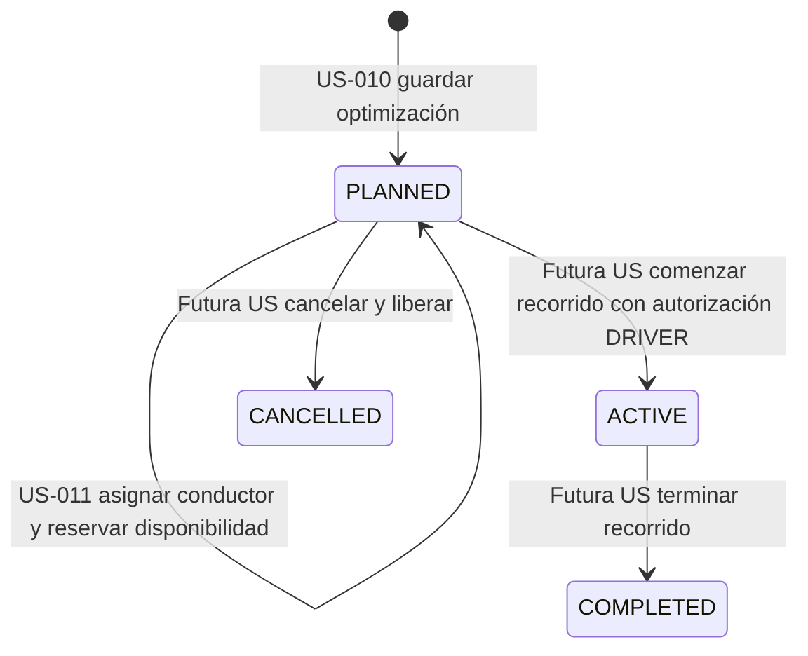
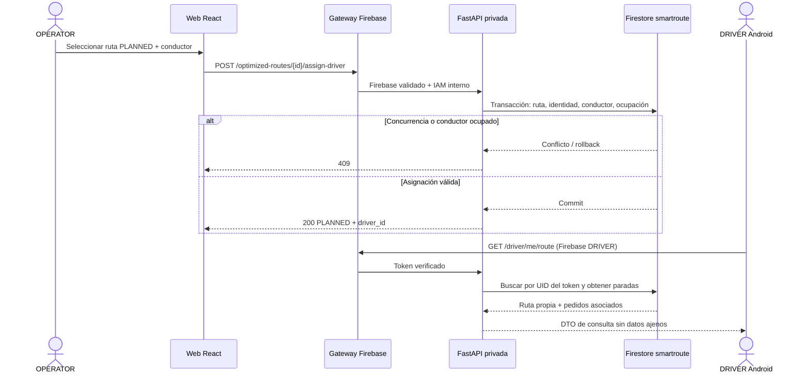

# US-011 — Asignación de conductores a rutas optimizadas (SDD)

**Proyecto:** SmartRoute AI · UPN Capstone  
**Estado:** propuesta de contrato (sin código desplegado)  
**Rama:** `feat/us011-driver-assignment` · **Base:** `main` en `d158eb0`  
**Alcance:** piloto con datos sintéticos, 1 ruta PLANNED por asignación, 1 conductor; GCP `proyectopersonal-480420`, Firestore nombrado `smartroute`.

## 1. Historia de usuario y valor

**US-011:** Como operador autenticado, quiero consultar conductores activos y asignar uno a una ruta optimizada `PLANNED`, de forma segura y transaccional, para que el conductor pueda consultar su trabajo desde Android sin recalcular la ruta.

**Entregable MVP:** un vínculo conductor–ruta, trazable y protegido por roles, con lectura propia desde la aplicación Android. **No** implica inicio de recorrido, GPS, estado `ACTIVE`, prueba de entrega ni navegación giro a giro.

## 2. Inventario de implementación existente (verificado en repositorio)

- `services/api/app/auth.py`: Firebase ID token; `users/{uid}` con `active: true` y `role: OPERATOR | DRIVER`. `require_operator` existe; falta `require_driver`. No se debe confiar en el rol del cliente.
- `services/api/app/optimized_routes.py`: `OptimizedRoute` contiene `status=PLANNED`, `driver_id: None`, `version`, `ordered_order_ids`, métricas y depot. **Antes de implementar la asignación, el contrato debe admitir `driver_id: str | None`**, manteniendo `PLANNED` hasta la activación futura.
- `services/api/app/firestore_optimized_routes.py`: `routes/{id}` con `route_type=OPTIMIZED`; reservas `orders/{id}` atómicas al guardar. Las órdenes ya están `ASSIGNED` a la ruta: asignar conductor **no** debe reservarlas otra vez.
- `services/api/app/routes.py` y `firestore_routes.py`: flujo legado `DRAFT`, `driver_id` obligatorio, asignación de pedidos; mantener compatible y aislado del flujo optimizado.
- `services/gateway/app/main.py`: allowlist explícita por método/path y Firebase/IAM. Agregar solo los endpoints necesarios; revisar CORS y `OPTIONS`.
- `apps/operator-web/src/main.jsx`: lista/recuperación de rutas guardadas y mapa. Agregar selector de conductor solo sobre ruta `PLANNED`.
- Android se desarrolla por separado: documentar contratos JSON y roles, **no modificar ni fusionar** su rama durante US-011.

## 3. Decisiones funcionales y políticas

1. **Identidad del conductor:** `driver_id` será el Firebase `uid` del perfil `users/{uid}` con `role=DRIVER`, `active=true`. Si se conserva un documento en `drivers/{uid}`, su ID debe coincidir con el UID y ser una proyección operativa; nunca usar email libre como identidad. Establecer esa regla en tests y migración.
2. **Disponibilidad:** inicialmente `drivers/{uid}.available=true` y `active=true` en el perfil; verificar **ambos documentos**, existencia y concordancia del UID. La asignación reserva capacidad en la misma transacción. Sin perfil válido: `404` o `409` según caso.
3. **Exclusividad:** un conductor no puede tener más de una ruta `PLANNED` asignada ni `ACTIVE` simultánea. Para impedir carreras, usar `driver_assignments/{uid}` como documento canónico de ocupación y leerlo/escribirlo en la **misma transacción** que `routes/{id}`. Documentar liberación controlada en una US posterior.
4. **Ruta:** el operador asigna solo rutas `OPTIMIZED`, `status=PLANNED`, `driver_id=null`. Tras asignar, conservar `PLANNED` (publicada/asignada, aún no iniciada), `ordered_order_ids`, métricas, geopuntos y reserva de pedidos. `version` se incrementa; agregar `assigned_at`, `assigned_by` y `updated_at`.
5. **Concurrencia:** `expected_version` exigido en POST, comparación transaccional contra versión de ruta. Repetición idéntica por mismo operador y clave idempotente debe responder el mismo resultado sin segunda mutación; reutilizar clave con payload distinto: `409`.
6. **Autorización:** `OPERATOR` puede listar candidatos y asignar. `DRIVER` puede consultar **solo** su ruta y sus paradas asignadas, mediante `current_user.uid` del servidor. La UI Android no puede enviar el ID de otro conductor para acceder a sus datos.
7. **Privacidad:** solo datos sintéticos del piloto. No retornar listado global de direcciones a un DRIVER ni incluir secretos ORS/Firebase en respuestas/logs.

### Estados (propuesta)



`PLANNED` con `driver_id=null` es una ruta sin conductor; `PLANNED` con `driver_id=uid` es una ruta asignada pero todavía no iniciada.

## 4. Contratos de API propuestos

Los endpoints atraviesan el gateway autenticado, que valida token Firebase y llama la API privada mediante identidad IAM de servicio.

| Método y path | Rol | Respuesta |
|---|---|---|
| `GET /api/v1/drivers?available=true&limit=20` | OPERATOR | `200` lista acotada de perfiles activos, disponibles y con identidad válida |
| `POST /api/v1/optimized-routes/{route_id}/assign-driver` | OPERATOR | `200` ruta asignada con conductor y versión incrementada |
| `GET /api/v1/driver/me/route` | DRIVER | `200` única ruta asignada `PLANNED/ACTIVE` o `204` sin ruta; nunca de otro conductor |

**Solicitud POST**

```json
{
  "driver_id": "<firebase-uid-del-conductor>",
  "expected_version": 1,
  "idempotency_key": "<uuid>"
}
```

**Respuesta de asignación (fragmento)**

```json
{
  "id": "<route-uuid>",
  "route_type": "OPTIMIZED",
  "status": "PLANNED",
  "driver_id": "<firebase-uid-del-conductor>",
  "version": 2,
  "assigned_by": "<firebase-uid-operador>",
  "assigned_at": "<UTC>",
  "ordered_order_ids": ["<uuid-pedido-2>", "<uuid-pedido-1>"]
}
```

`GET /api/v1/driver/me/route` devolverá un DTO mínimo con depot, paradas ordenadas `{sequence, order_id, address_label, geo}`, estado y métricas estimadas. Los detalles financieros, cuentas de otros conductores y listas globales quedan excluidos. **No invocar ORS para esta lectura:** las paradas deben resolverse desde snapshots seguros o `orders`, sin cambiar la secuencia.

**Errores:** `401` sin Firebase; `403` rol incorrecto/inactivo; `404` ruta o conductor inexistentes; `409` versión obsoleta, conductor ocupado, ruta ya asignada, idempotencia conflictiva; `422` ID/UUID o cuerpo inválido; `503` fallo Firestore.

## 5. Diseño de datos y transacción

`users/{uid}`: `{role:"DRIVER",active:true}` es fuente de identidad/autorización.

`drivers/{uid}`: `{uid,display_name,active:true,available:true,created_at,updated_at}`; campos operativos editados únicamente por OPERATOR/servicio confiable. No suponer que ya existen.

`driver_assignments/{uid}`: `{driver_id,route_id,status:"RESERVED",version,updated_at}` evita doble asignación bajo concurrencia; documentar explícitamente limpieza/cancelación posterior.

`routes/{routeId}` para `route_type=OPTIMIZED`: añadir `driver_id`, `assigned_by`, `assigned_at`, actualización de `version` y `updated_at`. Mantener `PLANNED`, `order_ids`, `ordered_order_ids`, métricas, `matrix_fingerprint` y snapshots **sin cambios**.

**Orden transaccional Firestore:** leer ruta, perfil `users`, `drivers`, `driver_assignments` y referencia de idempotencia; validar condiciones y versión; **después** aplicar escrituras a ruta, ocupación e idempotencia. Firestore exige lecturas antes de escrituras. Si falla, ninguna mutación parcial. Para carreras entre rutas del mismo conductor, serializar por `driver_assignments/{uid}` dentro de la transacción.

No modificar `orders/{id}` en US-011: quedaron `ASSIGNED` al persistir la ruta US-010.

## 6. Secuencia de interacción



## 7. Criterios de aceptación

| ID | Given / When | Then |
|---|---|---|
| AC-01 | OPERATOR, ruta `PLANNED` sin conductor y DRIVER activo/disponible | Asigna y aumenta versión; `status` sigue `PLANNED` |
| AC-02 | Asignación confirmada | Orden y métricas existentes no cambian; los pedidos no se vuelven a reservar |
| AC-03 | Dos operadores asignan la misma ruta simultáneamente | Una confirma y la otra falla `409` |
| AC-04 | Dos rutas intentan ocupar el mismo conductor | Solo una confirma; otra `409` |
| AC-05 | Versión vieja, conductor inactivo o no disponible | Rechazo controlado, sin escrituras parciales |
| AC-06 | Token DRIVER consulta `/driver/me/route` | Solo ve su propia ruta y sus direcciones ordenadas |
| AC-07 | DRIVER intenta asignar o listar conductores | `403`; sin token `401` |
| AC-08 | Idempotencia con misma solicitud | Retorna asignación previa; clave reutilizada con cuerpo distinto `409` |
| AC-09 | Reapertura del panel tras recarga | Conductor asignado visible, sin duplicar asignaciones |
| AC-10 | Conductor sin ruta | `204`, sin acceso global a rutas ni pedidos |

## 8. Pruebas y entrega incremental

1. **Contrato:** Pydantic y OpenAPI para asignación y lectura DRIVER; test de validación de versiones y UUID.
2. **Integración:** Firestore Emulator con carreras concurrentes por ruta/conductor, idempotencia y compatibilidad US-005/US-010.
3. **Seguridad:** Firebase role lookup, `require_driver`, gateway allowlist exacta, bloqueo de acceso cruzado y Firestore nombrado.
4. **Web:** selector de conductor activo, confirmación, feedback de conflicto, mostrar asignación sin exponer secretos.
5. **Android:** conectar el contrato `/driver/me/route` en rama Android separada; sin edición simultánea de archivos compartidos.
6. **Staging:** API y gateway primero, web después; credenciales de pruebas DRIVER con UID distinto del operador; demostrar asignación y lectura propia, documentar evidencias.
7. **CI/merge:** mantener PR draft hasta todos los tests verdes y E2E; merge a `main` por PR, no directo.

## 9. Riesgos y decisiones por verificar antes de implementar

- **Perfil DRIVER real:** la colección `drivers` aparece en el flujo legado, pero no se ha validado que tenga documentos válidos en staging; preparar un conductor de prueba sin utilizar identidad personal.
- **Contratos legados:** `OptimizedRoute.driver_id` tipado como `None` impide serializar una asignación hasta que se amplíe el modelo; agregar pruebas de migración.
- **Consistencia operacional:** una ruta `PLANNED` asignada aún no debe aparecer como `ACTIVE`; liberar ocupación exige operación transaccional futura.
- **Alcance Android:** el nuevo contrato es consumo, no una implementación Android terminada.
- **Concurrencia y costos:** transacciones acotadas; no consultar ORS, Google Maps ni otros servicios externos durante una transacción.
- **Seguridad de GCP:** permanecer únicamente en proyecto `proyectopersonal-480420`, base `smartroute`; no tocar `(default)` ni `gestioncitas`. Mantener FastAPI privado IAM y Firebase en gateway y API.

## 10. Definition of Done de US-011

Especificación revisada; contratos implementados con seguridad de roles, asignación atómica e idempotente; driver activo verificable; lectura `me` aislada; tests y CI aprobados; interfaz web validada y Android preparado para consumir API; evidencia staging sin datos reales ni secretos; PR integrado tras validación.
