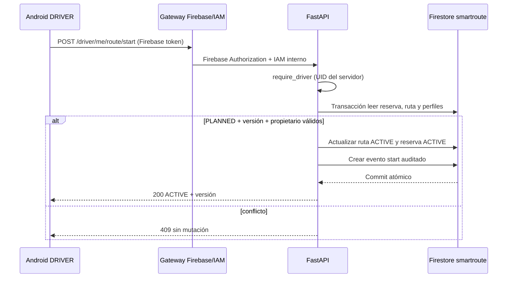

# US-012 — Inicio controlado y seguimiento del recorrido (SDD)

**Estado:** desarrollo en rama `feat/us012-route-execution`; **no desplegado**. **Base:** US-011 integrada en `main` y probada en staging. **Alcance inicial:** transicionar una ruta optimizada asignada de `PLANNED` a `ACTIVE`, exclusivamente desde el DRIVER propietario. El cierre de recorrido se pospone hasta definir entregas comprobables (US-013).

## 1. Contexto comprobado

- Firebase Authentication: la API valida token y `users/{uid}` con `role=DRIVER`, `active=true`.
- La asignación de US-011 crea atómicamente `routes/{route_id}.driver_id=uid` y `driver_assignments/{uid}` con `status=RESERVED`, `route_id`.
- `GET /api/v1/driver/me/route` resuelve la ruta mediante UID del servidor, nunca UID o route ID del cliente.
- `OptimizedRoute.status` solo aceptaba `PLANNED`: ampliar lectura para `ACTIVE` es requisito de compatibilidad.
- El gateway usa lista explícita por método y ruta; también debe admitir CORS OPTIONS exacto.

## 2. Historia

**Como DRIVER autenticado y dueño de una ruta PLANNED asignada, quiero iniciar el recorrido para que su estado cambie a ACTIVE y la web de operaciones observe el avance sin duplicar reservas.**

Fuera de alcance de esta primera entrega: GPS continuo, geofencing, navegación, modificar secuencia optimizada, iniciar rutas de otros conductores, confirmar entregas y completar rutas sin evidencias.

## 3. Contrato inicial propuesto

| Método | Path | Rol | Comportamiento |
| --- | --- | --- | --- |
| `POST` | `/api/v1/driver/me/route/start` | DRIVER | 200 — estado ACTIVE, versión incrementada |
| `GET` | `/api/v1/driver/me/route` | DRIVER | 200 — ruta propia PLANNED o ACTIVE, 204 sin asignación |
| `GET` | `/api/v1/optimized-routes` | OPERATOR | lista incluye ACTIVE sin perder compatibilidad |

Solicitud:

```json
{"expected_version":2,"idempotency_key":"8c40c1bb-2dde-41c2-81b1-8ab64a14ad53"}
```

Respuesta 200:

```json
{"id":"<route-id>","status":"ACTIVE","driver_id":"<verified-firebase-uid>","version":3,"started_at":"<UTC>"}
```

**Errores:** 401 sin token, 403 rol diferente o inactivo, 404 no existe reserva, 409 inconsistencias/version obsoleta/otro estado, 422 cuerpo inválido, 503 error Firestore. Reintento con misma clave/payload para el mismo DRIVER devuelve 200 sin segundo incremento; clave reutilizada para versión diferente causa 409.

## 4. Consistencia transaccional

1. Resolver `driver_assignments/{uid}` desde el UID verificado; obtener `route_id`, validar cadena sin `/`.
2. Transacción Firestore: **leer todos los documentos antes de escribir**: reserva, ruta, perfil `users/{uid}`, perfil `drivers/{uid}`.
3. Comprobar ambos perfiles activos, conductor propietario y ruta `OPTIMIZED` asignada en estado `PLANNED`; reserva `RESERVED` con relación recíproca.
4. Comparar versión esperada y clave idempotente. Prohibir rutas ajenas, sin conductor o con reserva inconsistente.
5. Actualizar `routes/{route_id}`: status ACTIVE, version+1, `started_at`, `started_by`, `updated_at`, `execution_start_key`, `execution_start_expected_version`.
6. Actualizar `driver_assignments/{uid}`: status ACTIVE, version+1, `started_at`, `updated_at`.
7. Crear evento `route_events/{uuid}` de transición con fecha/actor, sin tokens ni datos personales sensibles. La clave del evento es determinista a partir de UID+ruta+clave de idempotencia, para reintentos y auditabilidad.

**Regla crítica:** una ruta no puede saltar de PLANNED a COMPLETED. No liberar la reserva al iniciar. Sin cambio de órdenes hasta US-013.

## 5. Diagrama Mermaid



## 6. Pruebas / Definition of Done

- `DRIVER` correcto puede iniciar solamente su ruta; `OPERATOR` obtiene 403.
- No se permite pasar `driver_uid` ni `route_id` en la petición.
- Sin reserva: 404; duplicado con clave idéntica: 200 sin doble cambio; clave conflictiva: 409.
- Rechazar versión obsoleta, reserva ajena, conductor inactivo y rutas no optimizadas.
- Transacción registra evento sin exponer tokens; simultaneidad no da dos rutas al conductor.
- Después de iniciar, `GET /driver/me/route` devuelve ACTIVE y la web OPERATOR puede listar la ruta.
- CI, emulador Firestore, pruebas de roles y gateway antes de desplegar; prueba real con conductor piloto **solo tras aprobación explícita**, porque iniciar modifica el estado persistido.

## 7. Próximos incrementos

**US-013:** estados por entrega y evidencia. **US-012b:** cierre de ruta `ACTIVE → COMPLETED` únicamente si la política de entregas está satisfecha; liberar reserva en una misma transacción y construir reporte observado. **Web OPERATOR:** visualizar ACTIVE/PLANNED con actualización periódica manual, sin activar rutas por suplantación de rol.
